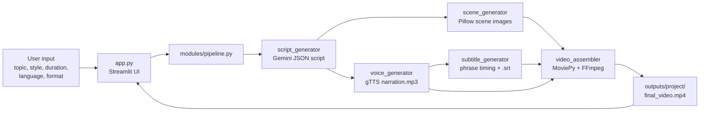

# ReelForge AI

**Turn Your Ideas Into Engaging AI-Powered Videos.**

ReelForge AI is a Streamlit web app that converts a text prompt into a short-form MP4 video
(Instagram Reels, YouTube Shorts, YouTube) using Google Gemini, gTTS, Pillow, MoviePy and FFmpeg.

## Problem Statement
Creating a short video normally needs several tools and skills: scriptwriting, voice-over, design and
video editing. For students, small businesses and educators this is slow and expensive.

## Proposed Solution
ReelForge AI automates the whole workflow. The user enters a topic, chooses a duration, style, language and
format, and the application produces a script, designed scenes, narration, subtitles and a downloadable MP4 - in one click.

## Main Features
- Modern dark dashboard (navy/black with blue-purple accents), responsive layout
- Inputs: topic, duration (30/45/60 s), style (6 options), language (English/Hindi), format (9:16 or 16:9)
- **Gemini script generation** returning structured JSON (title, description, narration, scenes, visual descriptions, on-screen text) with validation and automatic retry on malformed output
- **Pillow scene design**: gradient backgrounds, glows, emblems, headline cards, progress bar - no image API needed (the renderer is replaceable, see `modules/scene_generator.py`)
- **gTTS narration** in English or Hindi, with in-app audio preview
- **Subtitles** burned into the video at the bottom, wrapped so text stays inside the frame. Timing is *phrase-level*, estimated from each scene's real audio length - it is **not** word-level synchronisation. A `.srt` file is also saved.
- **Video assembly** with MoviePy + FFmpeg: scene durations follow the narration audio, fade transitions between scenes, H.264/AAC MP4
- Preview, script display and download (video, script, subtitles) in the browser
- Step-by-step progress and clear error messages
- Each run saves to its own folder in `outputs/` (nothing is overwritten)

## Technology Stack
| Purpose | Technology |
|---|---|
| Language / UI | Python, Streamlit |
| Script generation | Google Gemini (`google-genai`, model `gemini-3.8-flash`) |
| Voice | gTTS |
| Scene graphics | Pillow, NumPy |
| Video | MoviePy (1.x or 2.x), FFmpeg (via `imageio-ffmpeg`) |
| Configuration | python-dotenv |

## System Architecture


### Project structure
```
ReelForge-AI/
├── app.py                  # Streamlit dashboard
├── config.py               # model id, styles, formats, durations
├── check_setup.py          # one-command environment check
├── requirements.txt
├── .env / .env.example     # API key (never commit .env)
├── modules/
│   ├── pipeline.py         # runs the 6 steps
│   ├── script_generator.py
│   ├── scene_generator.py
│   ├── voice_generator.py
│   ├── subtitle_generator.py
│   └── video_assembler.py
├── utils/
│   ├── helpers.py          # fonts, wrapping, folders, FFmpeg check
│   └── moviepy_compat.py   # MoviePy 1.x / 2.x compatibility
├── assets/fonts/           # optional custom fonts
└── outputs/                # generated projects
```

## Installation (Windows / PowerShell / VS Code)
```powershell
cd ReelForge-AI
python -m venv .venv            # skip if you already have a virtual environment
.\.venv\Scripts\Activate.ps1
pip install -r requirements.txt
```
If PowerShell blocks activation, run once: `Set-ExecutionPolicy -Scope CurrentUser RemoteSigned`.

FFmpeg: `imageio-ffmpeg` (in requirements.txt) bundles an FFmpeg binary, so no separate install is normally needed.

## API Key Configuration
Create a file named `.env` next to `app.py` (copy `.env.example`):
```
GEMINI_API_KEY=your_actual_api_key
```
The key is read with python-dotenv and is never hardcoded. `.env` is listed in `.gitignore`.
Optional: `GEMINI_MODEL=...` overrides the default model ID `gemini-3.8-flash`.

## How to Run
```powershell
python check_setup.py       # optional but recommended
streamlit run app.py
```
Open http://localhost:8501 if the browser does not open automatically.

## Example Workflow
1. Enter *"How black holes work"*, choose **30 seconds**, **Documentary**, **English**, **Vertical (9:16)**.
2. Click **Generate Video** and watch the six progress steps.
3. Preview the video, listen to the narration, read the script, and click **Download Video**.

## Limitations
- Narration (gTTS) and scripts (Gemini) need an internet connection.
- Final length follows the narration speed, so it is close to - not exactly - the selected duration.
- Subtitles are phrase-level, not word-level.
- Hindi on-screen text needs a Devanagari font (Windows' *Nirmala UI* works) and correct rendering of complex Hindi letters depends on Pillow's text layout support.
- Scene visuals are generated graphics, not AI-generated imagery.

## Future Enhancements
- Plug in an AI image-generation API through the replaceable `SceneRenderer`
- Word-level subtitle timing with speech alignment
- More voices and languages, background music
- Ken Burns motion and richer transitions
- Project history and re-editing inside the dashboard
